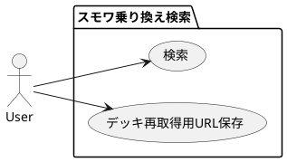
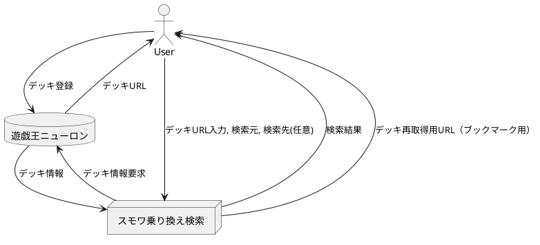
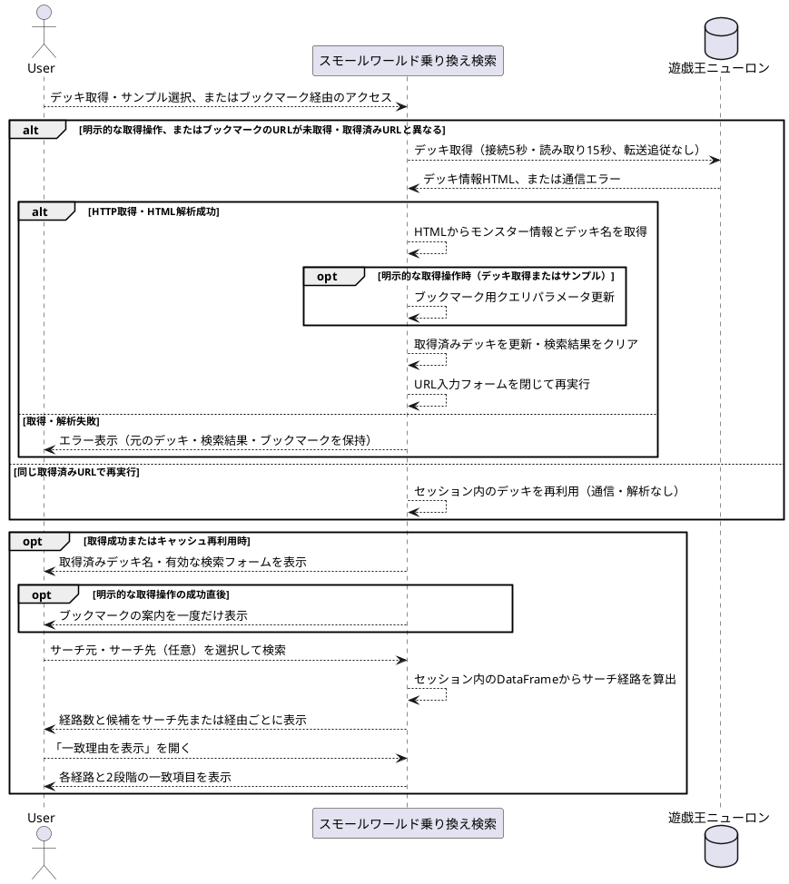
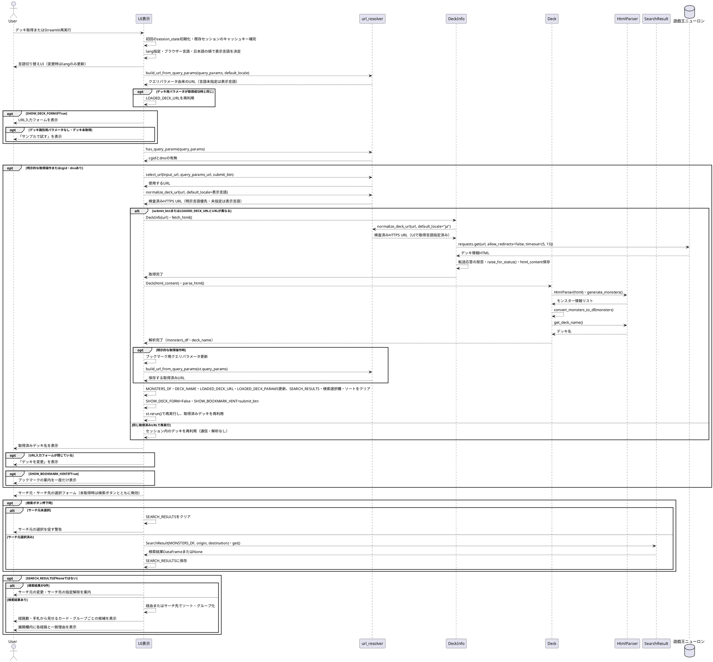
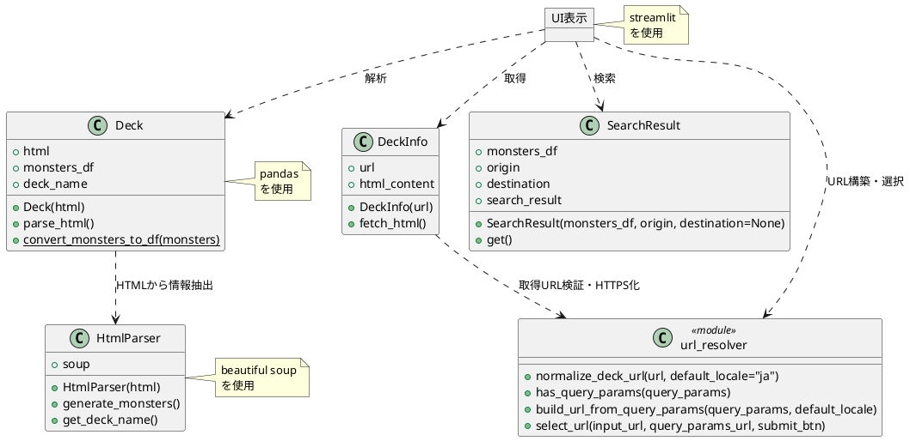
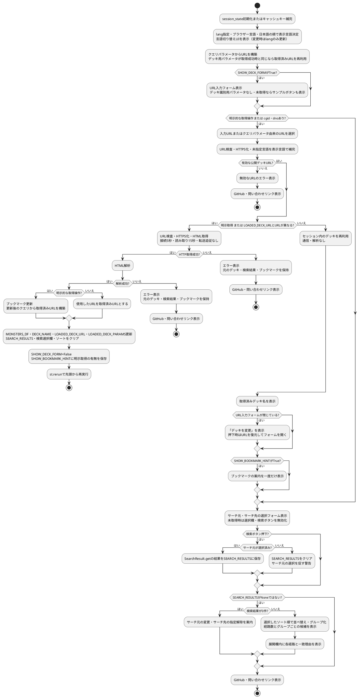

# ygo-small-world-transit

## 要件定義

1. スモールワールドのサーチ先が検索できる
1. 遊戯王ニューロンからデッキレシピを読み込める
1. PC/スマートフォンでの表示に対応
1. 読み込んだデッキを再取得するためのURLをブックマークできる

ブックマーク用URLには `cgid`、`dno`、`request_locale` を保存する。UI表示言語を指定・手動選択した場合は `lang` も維持する。従来の `lang` なしURLも利用できる。サーチ元・サーチ先の選択と検索結果はURLには保存しない。

### 多言語対応

- `resolve_language(browser_locale, lang=None)` はURLの `lang=ja` / `lang=en` を最優先し、未指定・未対応なら `st.context.locale`（ブラウザーの `navigator.language`）で言語を判定する。`en`・`en-US`・`en-GB` などの英語は `en`、その他・取得不能は `ja`。ページタイトルの設定前に判定し、`src/i18n.py` の翻訳辞書で画面の説明・操作・検索結果・エラー・フッターを表示する。英語の経路数は単数・複数を区別する。
- デッキ取得言語と画面の表示言語は分ける。入力URL・ブックマークの空でない `request_locale` を優先し、未指定・空文字なら表示言語を補完する。単独で呼ぶURL関数の既定は `ja`。サンプルと説明リンクは表示言語に合わせる。
- URLの正規化はUIでも取得前に行い、実際に取得した言語をブックマークに保存する。取得済みURLにも同じ言語を含め、検索・ソート時に再取得しない。取得成功時のデッキ用パラメータ（`cgid`・`dno`・`request_locale` の値と有無）を `LOADED_DECK_PARAMS` に保存し、これらが変わらなければ取得済みURLを再利用する。これにより取得言語未指定・空文字の旧ブックマークも、UI言語だけで再取得・カード名変更・検索結果クリアを起こさない。デッキ名は原文のままとする。
- 画面上部の `st.segmented_control`（「Language / 言語」、日本語・English）で現在言語を表示・切り替える。コールバックは `lang` のみ更新し、通常の再実行で翻訳とページタイトルを更新する。自動判定時はURLを変更せず、リダイレクト・URL正規化による言語誘導はしない。選択解除時は現在言語の選択を復元する。タイトルのホームリンクは有効な `lang=ja/en` の明示指定だけを引き継ぎ、初期画面に戻る。未指定・未対応時は言語指定なしのホームに戻り、ブラウザー判定を維持する。タイトルのCSSはホームURLの前方一致でクエリ付きリンクにも適用する。
- `lang` はUI専用、`request_locale` はデッキ情報取得用。両者は独立し、`?lang=en&cgid=xxx&dno=123&request_locale=ja` は英語UI・日本語カード情報となる。UI切り替え時はデッキの3パラメータを保持し、明示取得後のブックマーク更新時も `lang` を保持する。
- サーチ元・サーチ先の選択欄は固定キー、ソートは固定値（`transit` / `destination`）と翻訳表示を使い、UI切り替えで検索条件・結果・並び順を保持する。デッキ取得・解析成功時には選択欄とソートをリセットする。
- 公開先は引き続きStreamlit Community Cloudとし、英語版は `?lang=en` で直接参照できる。hreflang・canonicalの追加や静的SEOサイトは導入しない。
- 種族の抽出は日本語の `【種族／効果】` と英語の `[ Type / Effect ]` に対応し、`Winged Beast` などの空白は保持する。DataFrameの列名と検索計算は共通とする。
- ログ・内部例外メッセージは日本語のままとし、UIでは例外種別・コードに応じた翻訳文を表示する。予期しない例外の詳細はログに記録し、画面には再試行の案内を表示する。
- スリープ対策のPlaywrightは `locale="ja-JP"` に固定し、日本語のタイトル・入力欄・ボタンで起動を確認する。

### 画面の動作

- 初回はデッキURL入力フォームと検索フォームを表示する。デッキ未取得時はモンスターの選択欄と「経路を検索」を無効にする。デッキ識別用パラメータ（`cgid`・`dno` の両方）がない未取得状態（`lang` のみも含む）では「サンプルで試す」も表示し、押下時は所定の公開デッキを取得する。
- デッキ取得成功後はURL入力フォームを閉じ、読み込み済みのデッキ名と検索フォームを表示する。「デッキを変更」で直前のURLを復元して入力フォームを再表示でき、同じURLの再取得もできる。ブラウザーのページタイトルにも読み込んだデッキ名を反映する。
- 手札から見せるサーチ元は必須、サーチ先は任意。サーチ元未選択で検索すると以前の結果をクリアして選択を促す。経路が0件なら、サーチ元の変更やサーチ先の指定解除を案内する。
- 検索結果は経路数と候補をグループ表示する。既定はサーチ先ごとの経由候補で、「経由でソート」に切り替えると経由ごとのサーチ先候補を表示する。各グループの「一致理由を表示」を開くと、手札→経由→サーチ先の各経路と、属性・種族・レベル・攻撃力・守備力の一致項目を確認できる。

## データフロー図

## シーケンス図

### 概略版

### ソフトウェア詳細版

以下はデッキ取得・解析・検索の正常系を示す。**デッキ取得ボタン押下時は同じURLでも再取得する。「サンプルで試す」も明示的な取得操作として扱う。それ以外は、`cgid` と `dno` があり、デッキ用パラメータが変わらなければ取得済みURLを再利用し、異なる場合は新しく構築したURLが `LOADED_DECK_URL` と異なるときだけ取得・解析する。** 初回は `LOADED_DECK_URL` が `None` のため、ブックマークの指定があれば取得する。検索・並べ替えなど、同じ取得済みURLでの再実行はセッション内のデッキを再利用する。

取得前に `normalize_deck_url()` でスキーム（HTTP/HTTPS）・ホスト（`www.db.yugioh-card.com`）・パス（`/yugiohdb/member_deck.action`）と、空でない `cgid`・`dno` を検証する。取得URLはHTTPSに統一し、`request_locale` が未指定・空文字なら画面の表示言語を補完する（URL関数単独の既定は `ja`）。HTTP取得には接続5秒・読み取り15秒のタイムアウトを設定し、転送応答には追従しない。

取得・解析時の例外はUIで捕捉し、次のように案内を分ける。**失敗時は元のデッキ情報・検索結果・ブックマークを保持するが、その実行では検索フォーム・結果の表示まで進まない。**

| 例外 | 発生条件 | UIの案内 |
| --- | --- | --- |
| `NoMonsterError`（`ValueError` の派生） | メインデッキのモンスター領域が存在して空 | モンスターを含む公開デッキの指定 |
| `DeckStructureError`（`AttributeError` の派生） | HTML構造・必須項目・デッキ名のmeta情報の欠落、未知のモンスター領域の内容 | 再試行とデッキの公開設定の確認 |
| `requests.exceptions.RequestException` | 通信失敗・タイムアウト・HTTPの4xx/5xx | 通信状態の確認と再試行 |
| `DeckUrlError`（`ValueError` の派生） | 無効なURL・必須パラメータ不足 | エラーコードに応じた翻訳文 |
| `DeckRedirectError`（`ValueError` の派生） | 3xxの転送応答 | 取得先の転送を知らせる翻訳文 |
| その他の例外 | 予期しない処理エラー | 翻訳済みの再試行案内（詳細はログのみ） |

解析成功後、`MONSTERS_DF`・`DECK_NAME`・`LOADED_DECK_URL`・`LOADED_DECK_PARAMS` を更新し、`SEARCH_RESULTS` と検索選択欄・ソートをクリアする。明示的な取得操作時だけブックマークを更新し、更新後のクエリパラメータから取得済みURLを構築する。`SHOW_DECK_FORM` を `False` にして `st.rerun()` し、再実行後にデッキ名と検索フォームを表示する。明示取得時は `SHOW_BOOKMARK_HINT` によりブックマーク案内を一度だけ表示する。キャッシュはセッション単位で、新しいセッションでは再取得する。

## クラス図

`Deck.monsters_df` は `name`、`attribute`、`type`、`level`、`attack`、`defence` の6列を持つ DataFrame。`SearchResult` はこの6列を比較し、ちょうど1項目だけ一致する組を2段階つないで経路を列挙する。`get()` は `origin`、`transit`、`dest` の3列を持つ DataFrame（経路がなければ空）を返し、サーチ元が見つからない場合は `None` を返す。

## フローチャート

## 開発環境

* Python 3.12以上（CI・開発コンテナは3.12）
* github
* streamlit
* requests
* pandas
* beautifulsoup4
* lxml
* numpy
* pytest
* pytest-mock
* uv（依存関係の固定ファイル生成用。`requirements-tools.txt` で管理）
* Playwright・Chromium（スリープ対策スクリプトの検証用。追加インストールが必要）

依存関係の指定は `requirements.in`、間接依存を含む固定バージョンは `requirements.txt` で管理する。起動・全件テスト・依存関係の更新手順は [README](../README.md) を参照する。

コーディング規約はPython公式に従う。

https://docs.python.org/ja/3/tutorial/controlflow.html#intermezzo-coding-style

## 言語切り替えの検証

`test/i18n_test.py` でURL指定の優先順位・ブラウザー判定・フォールバック、翻訳キー・プレースホルダー・単複を検証する。`test/ui_language_test.py` のAppTestで言語切り替えと新規セッションでの再読み込み、旧ブックマーク・lang付きブックマーク・langのみ、取得言語の明示指定と未指定・空文字、サンプル・手動取得後のURL更新、再取得抑止、検索条件・結果・並び順保持を検証する。実ブラウザー・外部DBの確認はAppTestと区別してPRに記録する。
